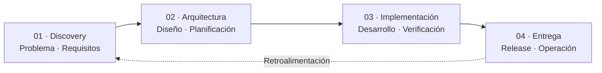

  
<a href="README.md">English</a> · Español

  <h1>Christopher Paz León</h1>
  
<strong>Software Engineer | Backend · Full-Stack · Applied AI</strong>

  
Diseño, construyo y despliego sistemas de software de extremo a extremo.

  

    
    
    
    
  

  
Perú · Inglés C1 · Disponible para oportunidades laborales

---

## Acerca de mí

Soy Software Engineer especializado en backend, con experiencia en desarrollo full-stack e IA aplicada. Diseño, desarrollo y opero sistemas de software, desde la arquitectura, las APIs y el modelado de datos hasta el despliegue cloud y la entrega a producción.

Mi trabajo abarca agentes autónomos, sistemas transaccionales, automatización distribuida de navegadores, pagos y productos web y móviles. Combino profundidad técnica con criterio de producto, documentación y responsabilidad integral.

## Dominios de ingeniería

<table>
  <tr>
    <td width="50%" valign="top"><h3>Backend Engineering</h3>APIs, arquitectura modular, concurrencia, transacciones y consistencia de datos.</td>
    <td width="50%" valign="top"><h3>Applied AI</h3>Agentes autónomos, tool calling, MCP, contexto persistente y procesamiento multimodal.</td>
  </tr>
  <tr>
    <td width="50%" valign="top"><h3>Cloud &amp; DevSecOps</h3>Contenedores, CI/CD, controles de seguridad y recuperación de despliegues.</td>
    <td width="50%" valign="top"><h3>Payments &amp; Billing</h3>Integraciones de pagos, suscripciones, wallets y ledgers transaccionales.</td>
  </tr>
  <tr>
    <td width="50%" valign="top"><h3>Full-Stack Engineering</h3>Aplicaciones web, extensiones de navegador y software móvil multiplataforma.</td>
    <td width="50%" valign="top"><h3>Software Architecture</h3>Diseño de sistemas, modelado de dominios, documentación técnica e ingeniería de producto.</td>
  </tr>
</table>

## Ciclo de ingeniería de software

Un enfoque de extremo a extremo que conecta requisitos de producto, diseño de sistemas, implementación y operación en producción. La retroalimentación alimenta la siguiente iteración.

## Proyecto de ingeniería destacado

<table>
  <tr>
    <td width="46%" valign="middle"></td>
    <td valign="top">
      <h3>Mirai</h3>
      
<strong>Full-Stack Software Engineer · Nov 2026 – Presente</strong> <em>Proyecto independiente no comercial</em>

      
Agente autónomo para descubrir oportunidades laborales, preparar candidaturas y gestionar campañas mediante el navegador local del usuario.

      
Backend modular en Node.js, control de concurrencia en PostgreSQL, Google ADK / Vertex AI, automatización de navegador mediante MCP, billing con Paddle y despliegue en Google Cloud.

      
<a href="https://github.com/Paz1CP/mirai"><strong>Código fuente</strong></a> · <a href="https://github.com/Paz1CP/mirai/blob/main/docs/architecture/mirai_architecture.md">Arquitectura</a> · <a href="https://mirai-web-4nag7kzycq-uk.a.run.app">Aplicación</a>

    </td>
  </tr>
</table>

## Experiencia profesional

<table>
  <tr>
    <td width="40%" valign="middle"></td>
    <td valign="top">
      <h3>CookPilot</h3>
      
<strong>Founder & Lead Product Engineer</strong> Oct 2025 – Nov 2026

      
Sistema operativo culinario que conecta planificación, recetas, nutrición, compras, costos y asistencia durante la cocina.

      
Diseñé y desarrollé el producto de extremo a extremo: modelado relacional, backend PostgreSQL/Supabase, motor de precios, IA multimodal, MediaPipe, Flutter e integraciones de suscripciones y compras in-app.

      
<a href="https://www.christopherpaz.dev/?experience=cookpilot#experience"><strong>Detalle de experiencia</strong></a> · <a href="https://cookpilot.pro/">Sitio web</a> · <a href="https://play.google.com/store/apps/details?id=com.cookpilot.pe">Google Play</a>

    </td>
  </tr>
</table>

<table>
  <tr>
    <td width="40%" valign="middle"></td>
    <td valign="top">
      <h3>JobMatch</h3>
      
<strong>Technical Product Lead — Contract</strong> May 2025 – Mar 2026

      
Plataforma de recruiting y matching laboral para candidatos, empresas y reclutadores.

      
Lideré la arquitectura e implementación del MVP, construí el backend PostgreSQL/Supabase y el matching asistido por IA, y migré Flutter Web a Next.js. El MVP alcanzó más de 100 usuarios; contribuí al fundamento técnico del producto que obtuvo S/67 000 mediante ProInnóvate / Startup Perú 12G.

      
<a href="https://www.christopherpaz.dev/?experience=jobmatch#experience"><strong>Detalle de experiencia</strong></a> · <a href="https://www.jmperu.com/es">Sitio web</a>

    </td>
  </tr>
</table>

<table>
  <tr>
    <td width="40%" valign="middle"></td>
    <td valign="top">
      <h3>4Track / VistoGPS</h3>
      
<strong>Mobile Software Engineer</strong> Oct 2024 – Oct 2025

      
Plataforma de seguimiento GPS en tiempo real y gestión de flotas.

      
Fui responsable de mobile/frontend en aplicaciones de producción de una plataforma con más de 5 000 clientes. Implementé WebSockets, mapas, sincronización offline, autenticación y persistencia local, colaborando con equipos de backend e infraestructura. Publiqué aplicaciones en Google Play, App Store y Huawei AppGallery.

      
<a href="https://www.christopherpaz.dev/?experience=4track-vistogps-pro#experience"><strong>Detalle de experiencia</strong></a> · <a href="https://play.google.com/store/apps/details?id=gps.app4track.com">Google Play</a>

    </td>
  </tr>
</table>

## Evidencia de ingeniería

Implementaciones y evidencias públicas seleccionadas de mi trabajo.

| Capacidad | Implementación | Evidencia |
|---|---|---|
| Arquitectura backend | Monolito modular y contratos tipados; modelos relacionales de dominio. | [Mirai](https://github.com/Paz1CP/mirai/blob/main/docs/architecture/mirai_architecture.md) · [CookPilot](https://www.christopherpaz.dev/?experience=cookpilot#experience) |
| Consistencia de datos | Transacciones, advisory locks, idempotencia y control de revisiones. | [Mirai](https://github.com/Paz1CP/mirai/tree/main/docs) · [CookPilot](https://www.christopherpaz.dev/?experience=cookpilot#experience) |
| Sistemas distribuidos y en tiempo real | Ejecución cloud a navegador local e integración GPS en tiempo real. | [Mirai](https://github.com/Paz1CP/mirai/blob/main/docs/architecture/mirai_architecture.md) · [4Track](https://www.christopherpaz.dev/?experience=4track-vistogps-pro#experience) |
| IA aplicada | Orquestación de agentes, extracción multimodal y matching asistido por IA. | [Mirai](https://github.com/Paz1CP/mirai/tree/main/docs) · [CookPilot](https://www.christopherpaz.dev/?experience=cookpilot#experience) · [JobMatch](https://www.christopherpaz.dev/?experience=jobmatch#experience) |
| Ingeniería de pagos | Wallets, ledger transaccional, webhooks firmados, suscripciones y compras. | [Mirai](https://github.com/Paz1CP/mirai/tree/main/docs) · [CookPilot](https://www.christopherpaz.dev/?experience=cookpilot#experience) |
| Entrega a producción | Releases cloud en contenedores y entrega móvil multi-store. | [Release verificada](https://github.com/Paz1CP/mirai/actions/runs/45615408735) · [CookPilot](https://play.google.com/store/apps/details?id=com.cookpilot.pe) |
| Seguridad de despliegue | Controles de migración y recuperación verificada de revisiones. | [Release bloqueada](https://github.com/Paz1CP/mirai/actions/runs/45611946799) · [Rollback](https://github.com/Paz1CP/mirai/actions/runs/45616829512) · [CI/CD](https://github.com/Paz1CP/mirai/blob/main/docs/platform/mirai_ci_cd.md) |

## Stack tecnológico

| Dominio | Tecnologías |
|---|---|
| **Lenguajes** |       Contratos tipados, programación asíncrona y consultas relacionales. |
| **Backend y datos** |           APIs REST, arquitectura modular, transacciones, concurrencia, idempotencia, coordinación orientada a eventos y RLS. |
| **IA aplicada** |          Agentes autónomos, tool calling, context engineering, streaming, salidas estructuradas y procesamiento multimodal. |
| **Cloud y DevSecOps** |            CI/CD, pruebas de integración, controles de migraciones, OIDC/WIF, análisis de contenedores y rollback. |
| **Frontend y mobile** |          Aplicaciones web, contratos cliente-servidor tipados, extensiones de navegador y desarrollo móvil multiplataforma. |
| **Pagos e integraciones** |         Suscripciones, compras in-app, wallets, ledgers transaccionales, webhooks firmados y liquidación de consumo. |
| **Ingeniería de software y producto** |      Diseño de sistemas, modelado de dominios, requisitos, documentación C4, seguridad de APIs y responsabilidad integral. |

---

  <h3>Contacto</h3>
  
Disponible para oportunidades de ingeniería de software: remoto, híbrido o presencial en Perú, y equipos remotos internacionales.

  

    <a href="https://www.christopherpaz.dev/"><strong>christopherpaz.dev</strong></a> · <a href="https://www.linkedin.com/in/pazleon/">LinkedIn</a> · <a href="mailto:contact@christopherpaz.dev">contact@christopherpaz.dev</a>
  

  
Ingeniería de software · De la arquitectura a producción.

