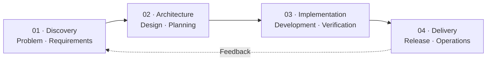

  
English · <a href="README.es.md">Español</a>

  <h1>Christopher Paz León</h1>
  
<strong>Software Engineer | Backend · Full-Stack · Applied AI</strong>

  
Designing, building and deploying software systems end to end.

  

    
    
    
    
  

  
Peru · English C1 · Open to work

---

## About me

I am a software engineer specializing in backend engineering, with experience in full-stack development and applied AI. I design, build and operate software systems, from architecture, APIs and data modeling to cloud deployment and production delivery.

My work spans autonomous agents, transactional systems, distributed browser automation, payments and web and mobile products. I combine engineering depth with product thinking, technical documentation and end-to-end ownership.

## Engineering domains

<table>
  <tr>
    <td width="50%" valign="top"><h3>Backend Engineering</h3>APIs, modular architecture, concurrency, transactions and data consistency.</td>
    <td width="50%" valign="top"><h3>Applied AI</h3>Autonomous agents, tool calling, MCP, persistent context and multimodal processing.</td>
  </tr>
  <tr>
    <td width="50%" valign="top"><h3>Cloud &amp; DevSecOps</h3>Containers, CI/CD, security gates and deployment recovery.</td>
    <td width="50%" valign="top"><h3>Payments &amp; Billing</h3>Payment integrations, subscriptions, wallets and transactional ledgers.</td>
  </tr>
  <tr>
    <td width="50%" valign="top"><h3>Full-Stack Engineering</h3>Web applications, browser extensions and cross-platform mobile software.</td>
    <td width="50%" valign="top"><h3>Software Architecture</h3>System design, domain modeling, technical documentation and product engineering.</td>
  </tr>
</table>

## Software Engineering Lifecycle

An end-to-end approach that connects product requirements, system design, implementation and production operation. Feedback informs the next iteration.

## Featured engineering project

<table>
  <tr>
    <td width="46%" valign="middle"></td>
    <td valign="top">
      <h3>Mirai</h3>
      
<strong>Full-Stack Software Engineer · Nov 2026 – Present</strong> <em>Independent, non-commercial project</em>

      
Autonomous agent for job discovery, application preparation and campaign management through the user’s local browser.

      
Modular Node.js backend, PostgreSQL concurrency controls, Google ADK / Vertex AI, MCP browser automation, Paddle billing and Google Cloud delivery.

      
<a href="https://github.com/Paz1CP/mirai"><strong>Source code</strong></a> · <a href="https://github.com/Paz1CP/mirai/blob/main/docs/architecture/mirai_architecture.md">Architecture</a> · <a href="https://mirai-web-4nag7kzycq-uk.a.run.app">Live application</a>

    </td>
  </tr>
</table>

## Professional experience

<table>
  <tr>
    <td width="40%" valign="middle"></td>
    <td valign="top">
      <h3>CookPilot</h3>
      
<strong>Founder & Lead Product Engineer</strong> Oct 2025 – Nov 2026

      
Culinary operating system connecting meal planning, recipes, nutrition, grocery shopping, costs and cooking assistance.

      
Designed the product end to end: relational domain modeling, PostgreSQL/Supabase backend, pricing engine, multimodal AI, MediaPipe, Flutter and subscription/in-app purchase integrations.

      
<a href="https://www.christopherpaz.dev/?experience=cookpilot#experience"><strong>Experience details</strong></a> · <a href="https://cookpilot.pro/">Website</a> · <a href="https://play.google.com/store/apps/details?id=com.cookpilot.pe">Google Play</a>

    </td>
  </tr>
</table>

<table>
  <tr>
    <td width="40%" valign="middle"></td>
    <td valign="top">
      <h3>JobMatch</h3>
      
<strong>Technical Product Lead — Contract</strong> May 2025 – Mar 2026

      
Recruiting and job-matching platform for candidates, companies and recruiters.

      
Led the MVP architecture and implementation, built the PostgreSQL/Supabase backend and AI-assisted matching, and migrated Flutter Web to Next.js. The MVP reached 100+ users; I contributed to the technical foundation of the product that secured PEN 67,000 through ProInnóvate / Startup Perú 12G.

      
<a href="https://www.christopherpaz.dev/?experience=jobmatch#experience"><strong>Experience details</strong></a> · <a href="https://www.jmperu.com/es">Website</a>

    </td>
  </tr>
</table>

<table>
  <tr>
    <td width="40%" valign="middle"></td>
    <td valign="top">
      <h3>4Track / VistoGPS</h3>
      
<strong>Mobile Software Engineer</strong> Oct 2024 – Oct 2025

      
Real-time GPS tracking and fleet management platform.

      
Owned mobile/frontend engineering for production applications on a platform serving 5,000+ customers. Implemented WebSockets, maps, offline synchronization, authentication and local persistence, collaborating with backend and infrastructure teams. Released apps across Google Play, App Store and Huawei AppGallery.

      
<a href="https://www.christopherpaz.dev/?experience=4track-vistogps-pro#experience"><strong>Experience details</strong></a> · <a href="https://play.google.com/store/apps/details?id=gps.app4track.com">Google Play</a>

    </td>
  </tr>
</table>

## Engineering evidence

Selected implementations and public evidence across my work.

| Capability | Implementation | Evidence |
|---|---|---|
| Backend architecture | Modular monolith and typed contracts; relational domain models. | [Mirai](https://github.com/Paz1CP/mirai/blob/main/docs/architecture/mirai_architecture.md) · [CookPilot](https://www.christopherpaz.dev/?experience=cookpilot#experience) |
| Data consistency | Transactions, advisory locks, idempotency and revision control. | [Mirai](https://github.com/Paz1CP/mirai/tree/main/docs) · [CookPilot](https://www.christopherpaz.dev/?experience=cookpilot#experience) |
| Distributed & real-time systems | Cloud-to-local browser execution and real-time GPS integration. | [Mirai](https://github.com/Paz1CP/mirai/blob/main/docs/architecture/mirai_architecture.md) · [4Track](https://www.christopherpaz.dev/?experience=4track-vistogps-pro#experience) |
| Applied AI | Agent orchestration, multimodal extraction and AI-assisted matching. | [Mirai](https://github.com/Paz1CP/mirai/tree/main/docs) · [CookPilot](https://www.christopherpaz.dev/?experience=cookpilot#experience) · [JobMatch](https://www.christopherpaz.dev/?experience=jobmatch#experience) |
| Payments engineering | Wallets, transactional ledger, signed webhooks, subscriptions and purchases. | [Mirai](https://github.com/Paz1CP/mirai/tree/main/docs) · [CookPilot](https://www.christopherpaz.dev/?experience=cookpilot#experience) |
| Production delivery | Containerized cloud releases and multi-store mobile delivery. | [Verified release](https://github.com/Paz1CP/mirai/actions/runs/45615408735) · [CookPilot](https://play.google.com/store/apps/details?id=com.cookpilot.pe) |
| Deployment safety | Migration gates and verified revision recovery. | [Blocked release](https://github.com/Paz1CP/mirai/actions/runs/45611946799) · [Rollback](https://github.com/Paz1CP/mirai/actions/runs/45616829512) · [CI/CD](https://github.com/Paz1CP/mirai/blob/main/docs/platform/mirai_ci_cd.md) |

## Technology stack

| Domain | Technologies |
|---|---|
| **Languages** |       Typed contracts, asynchronous programming and relational queries. |
| **Backend & Data** |           REST APIs, modular architecture, transactions, concurrency, idempotency, event-driven coordination and RLS. |
| **Applied AI** |          Autonomous agents, tool calling, context engineering, streaming, structured outputs and multimodal processing. |
| **Cloud & DevSecOps** |            CI/CD, integration testing, migration gates, OIDC/WIF, container scanning and rollback. |
| **Frontend & Mobile** |          Web applications, typed client-server contracts, browser extensions and cross-platform mobile delivery. |
| **Payments & Integrations** |         Subscriptions, in-app purchases, wallets, transactional ledgers, signed webhooks and usage settlement. |
| **Software & Product Engineering** |      System design, domain modeling, requirements, C4 documentation, API security and end-to-end ownership. |

---

  <h3>Contact</h3>
  
Open to software engineering opportunities: remote, hybrid or on-site in Peru, and international remote teams.

  

    <a href="https://www.christopherpaz.dev/"><strong>christopherpaz.dev</strong></a> · <a href="https://www.linkedin.com/in/pazleon/">LinkedIn</a> · <a href="mailto:contact@christopherpaz.dev">contact@christopherpaz.dev</a>
  

  
Software Engineering · From architecture to production.

